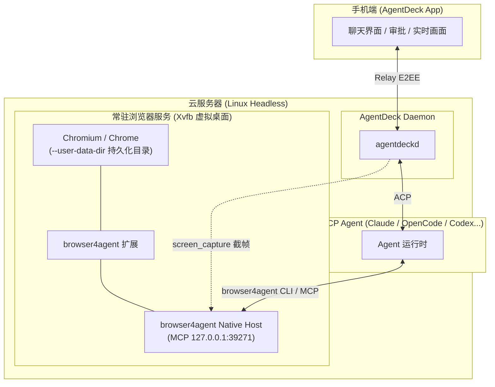

# 云端无头环境部署与浏览器配置指南

本指南介绍如何在 Linux 云服务器（无物理显示器环境）中部署 **AgentDeck Daemon (`agentdeckd`)**，并配置持久化的 **Chromium + browser4agent**，实现：
- 随时通过手机 App 远程连接云端 Agent；
- Agent 使用固定的常驻浏览器，保存已登录账号态与 Cookie；
- 截取网页登录二维码并在手机上扫码登录；
- 将浏览器实时画面推流到手机（`agentdeck-screen` 实时观察）。

---

## 整体架构



---

## 步骤一：安装与配置 agentdeckd

### 1. 安装 Daemon
可以通过 npm 或直接下载官方预编译二进制：

```bash
# 方式 A：通过 npm 全局安装
npm install -g agentdeckd

# 方式 B：从 GitHub Release 下载预编译二进制解压到 /usr/local/bin
```

### 2. 启动服务与配对
```bash
# 启动 daemon（初次运行会生成配对密钥和二维码）
agentdeckd
```
终端会输出配对信息与二维码：
* 打开手机上的 AgentDeck App；
* 扫描终端上的配对二维码（或手动输入 `agentdeck://connect?pairingId=...`）；
* 配对成功后，设备标识与密钥将持久化，后续无需重复配对。

*(推荐通过 `systemd` 将其配置为开机自启系统服务，详见后文)*

---

## 步骤二：安装 Chromium 与 Xvfb 虚拟桌面

云端无物理显示器，Chromium 运行完整扩展及排版渲染需要借由 **Xvfb**（X Virtual Framebuffer）提供虚拟屏幕。

### 1. 安装系统依赖与中文字体
```bash
sudo apt-get update && sudo apt-get install -y \
    xvfb \
    chromium-browser \
    fonts-noto-cjk \
    fonts-wqy-zenhei \
    curl \
    unzip
```
> **提示**：安装 CJK 中文字体非常重要，可避免无头网页在截图和推流时出现方块乱码。

### 2. 准备持久化用户数据目录
为了确保登录态、Cookies、LocalStorage 永久保存，需建立固定的用户数据目录：
```bash
mkdir -p /home/ubuntu/.chrome-user-data
```

---

## 步骤三：安装与配置 browser4agent (b4a)

`browser4agent` 由两部分组成：
1. **浏览器扩展**：注入页面、提供页面工具、捕获标签页内容。
2. **Native Host / MCP 服务**：在本地 `127.0.0.1:39271` 暴露 MCP 接口与 CLI 工具。

### 1. 下载并安装 browser4agent CLI / Native Host
从 [browser4agent Releases](https://github.com/mantou132/browser4agent/releases/latest) 下载对应 Linux 架构的二进制包，放置到系统 PATH：
```bash
# 解压后将二进制移动至 /usr/local/bin
sudo mv browser4agent /usr/local/bin/
sudo chmod +x /usr/local/bin/browser4agent

# 执行一次初始化配置（自动配置 Skill 与 Native Host 注册表）
browser4agent --setup skills
```

### 2. 下载 browser4agent 浏览器扩展
从 Releases 下载 `extension-chrome.zip` 并解压到指定目录：
```bash
mkdir -p /home/ubuntu/extensions/browser4agent
cd /home/ubuntu/extensions/browser4agent
curl -LO https://github.com/mantou132/browser4agent/releases/latest/download/extension-chrome.zip
unzip extension-chrome.zip
```

---

## 步骤四：配置为常驻 systemd 服务

创建 systemd 服务，使虚拟桌面环境与 Chromium 伴随系统开机自动常驻运行。

创建服务文件：`/etc/systemd/system/agentdeck-browser.service`
```ini
[Unit]
Description=Persistent Chromium with browser4agent under Xvfb
After=network.target

[Service]
Type=simple
User=ubuntu
Environment="DISPLAY=:99"
# 启动 Xvfb 并在其下运行常驻 Chromium
ExecStart=/usr/bin/xvfb-run -n 99 --server-args="-screen 0 1920x1080x24" \
    chromium-browser \
    --no-sandbox \
    --disable-gpu \
    --remote-debugging-port=9222 \
    --user-data-dir=/home/ubuntu/.chrome-user-data \
    --load-extension=/home/ubuntu/extensions/browser4agent \
    --no-first-run \
    --no-default-browser-check \
    about:blank
Restart=always
RestartSec=5

[Install]
WantedBy=multi-user.target
```

启动并启用开机自启：
```bash
sudo systemctl daemon-reload
sudo systemctl enable --now agentdeck-browser.service
```

验证运行状态：
```bash
# 检查 b4a MCP 服务端口是否正常监听
curl http://127.0.0.1:39271/mcp
# 检查 CLI 是否能正常列出标签页
browser4agent --tool list_tabs
```

---

## 步骤五：AgentDeck 识别与日常使用流程

完成上述配置后，AgentDeck Daemon 与各 Agent 将自动协同工作：

### 1. 网页登录与扫码
* 当 Agent 访问需要登录的网站时，调用 `browser4agent --tool screenshot_tab` 获取登录页面截图（或二维码局部图）。
* Agent 在回复中发送 Markdown 格式图片：
  ```markdown
  请使用手机扫描以下二维码登录：
  
  ```
* 手机端收到图片后，直接长按识别或使用对应 App 扫码。
* 扫码成功后，登录凭据将直接保存在 `/home/ubuntu/.chrome-user-data`，后续会话长期有效。

### 2. 实时画面投屏到手机
当 Agent 操作网页或你希望实时监视浏览器时：
* Agent 回复中携带 `agentdeck-screen` 代码块：
  ````markdown
  ```agentdeck-screen
  browser:12345
  ```
  ````
* 手机 App 会显示一个屏幕卡片，点击打开 **Live View**。
* `agentdeckd` 自动向本地 `127.0.0.1:39271/mcp` 请求画面截图，并通过 Relay ephemeral 连续推流到手机。

### 3. Agent 约定与指引
在项目工作区根目录下配置 `AGENTS.md` 或 `CLAUDE.md`，帮助 Agent 更好地了解环境：
```markdown
## 浏览器环境
云端已常驻运行 Chromium，并加载了 browser4agent 扩展。
- 浏览器控制优先使用 `browser4agent` 相关工具或 CLI。
- 遇需登录页面，截取二维码图片输出到聊天中供用户扫码。
- 如需向用户展示页面效果，使用 `agentdeck-screen` 语法块提供实时画面。
```
