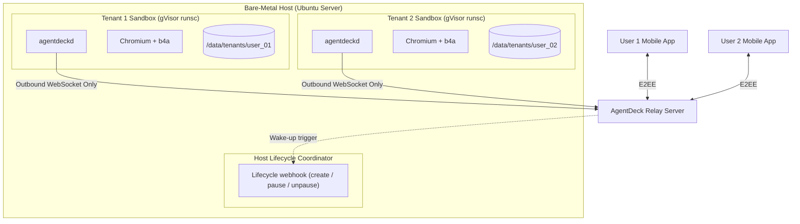

# Cloud Deployment and Environment Isolation Guide

This guide provides setup and configuration recipes for running **AgentDeck Daemon (`agentdeckd`)** and persistent headless browsers (**Chromium + browser4agent**) on remote Linux cloud servers.

---

## Deployment Scenarios Matrix

Choose the setup that best matches your target environment:

| Scenario | Target Audience | Isolation Level | Complexity | Key Highlights |
| :--- | :--- | :--- | :--- | :--- |
| **Scenario 1: Bare-Metal VPS (Direct Host)** | Individual developer running on a dedicated cloud VPS (Hetzner, DigitalOcean, etc.) | Host-level (Single tenant) | ⭐ (Minimal) | Zero virtualization overhead; managed directly via systemd and native CLI. |
| **Scenario 2: Single-User Docker Container** | Individual developer who prefers a clean, containerized setup without polluting host packages | Container-level (Standard Docker) | ⭐⭐ (Moderate) | Clean reproducibility; all development runtimes and browser pre-packaged in one image. |
| **Scenario 3: Multi-Tenant Secure Sandbox** | Teams, organizations, or multi-tenant SaaS cloud workspaces (Team247 / Cloud Workspaces) | **Micro-sandbox (gVisor `runsc`)** | ⭐⭐⭐ (Production) | Intercepts untrusted agent syscalls to prevent host kernel exploits; strict cgroup quotas; 10ms memory pause and fast wake-up. |

---

## Scenario 1: Bare-Metal VPS (Direct Host)

Recommended for personal users who own a dedicated Linux VPS and want their agent and browser running 24/7.

### 1. Install and Start `agentdeckd`
```bash
# 1. Install agentdeckd globally
npm install -g agentdeckd
# Or download the prebuilt binary from GitHub Releases to /usr/local/bin

# 2. Enable systemd user session persistence (Linger)
# Crucial: Ensures background processes stay alive after SSH disconnects and auto-start on boot
sudo loginctl enable-linger $USER

# 3. Register autostart service and start immediately
agentdeckd start

# 4. Check status and view Pairing QR code
agentdeckd status
```
Scan the terminal pairing QR code with your mobile AgentDeck app to complete pairing.

### 2. Install Headless Chromium and Xvfb Virtual Framebuffer
```bash
sudo apt-get update && sudo apt-get install -y \
    xvfb chromium-browser fonts-noto-cjk fonts-wqy-zenhei curl unzip
```
> **Note**: Installing CJK fonts prevents square-box glyph fallback when rendering Asian characters in screenshots and live stream.

### 3. Install and Configure `browser4agent` (b4a)
```bash
# Install CLI / Native Host
sudo curl -fsSL https://github.com/mantou132/browser4agent/releases/latest/download/browser4agent-linux-x86_64.tar.gz | sudo tar -xz -C /usr/local/bin/
sudo chmod +x /usr/local/bin/browser4agent
browser4agent --setup skills

# Download and unpack the browser extension
mkdir -p ~/.config/browser4agent-ext
curl -fsSL https://github.com/mantou132/browser4agent/releases/latest/download/extension-chrome.zip -o /tmp/ext.zip
unzip /tmp/ext.zip -d ~/.config/browser4agent-ext && rm /tmp/ext.zip
```

### 4. Create Background Browser Service (`agentdeck-browser.service`)
Create `/etc/systemd/system/agentdeck-browser.service`:
```ini
[Unit]
Description=Persistent Headless Chromium under Xvfb
After=network.target

[Service]
Type=simple
User=ubuntu
Environment="DISPLAY=:99"
ExecStart=/usr/bin/xvfb-run -n 99 --server-args="-screen 0 1920x1080x24" \
    chromium-browser \
    --no-sandbox \
    --disable-gpu \
    --remote-debugging-port=9222 \
    --user-data-dir=/home/ubuntu/.chrome-user-data \
    --load-extension=/home/ubuntu/.config/browser4agent-ext \
    --no-first-run \
    --no-default-browser-check \
    about:blank
Restart=always
RestartSec=5

[Install]
WantedBy=multi-user.target
```
Enable and start the service:
```bash
sudo systemctl enable --now agentdeck-browser.service
```

---

## Scenario 2: Single-User Docker Container

Packages the complete runtime (Node.js, Python, Git, Chromium, Xvfb, b4a, and `agentdeckd`) into a single container image.

### 1. Configuration Files

Create an `agentdeck-docker` directory with the following files:

**`Dockerfile`**:
```dockerfile
FROM ubuntu:24.04

ENV DEBIAN_FRONTEND=noninteractive
ENV DISPLAY=:99

RUN apt-get update && apt-get install -y \
    curl git wget unzip procps xvfb ca-certificates \
    chromium-browser fonts-noto-cjk fonts-wqy-zenhei \
    python3 python3-pip \
    && curl -fsSL https://deb.nodesource.com/setup_22.x | bash - \
    && apt-get install -y nodejs \
    && npm install -g pnpm agentdeckd @anthropic-ai/claude-code \
    && rm -rf /var/lib/apt/lists/*

# Install browser4agent CLI and extension
WORKDIR /opt/browser4agent
RUN curl -LO https://github.com/mantou132/browser4agent/releases/latest/download/browser4agent-linux-x86_64.tar.gz \
    && tar -xvf browser4agent-linux-x86_64.tar.gz \
    && mv browser4agent /usr/local/bin/ \
    && rm browser4agent-linux-x86_64.tar.gz \
    && curl -LO https://github.com/mantou132/browser4agent/releases/latest/download/extension-chrome.zip \
    && unzip extension-chrome.zip -d /opt/browser4agent-ext \
    && rm extension-chrome.zip

COPY entrypoint.sh /entrypoint.sh
RUN chmod +x /entrypoint.sh

WORKDIR /workspace
ENTRYPOINT ["/entrypoint.sh"]
```

**`entrypoint.sh`**:
```bash
#!/bin/bash
set -e

# Start Xvfb and Chromium in background
nohup xvfb-run -n 99 --server-args="-screen 0 1920x1080x24" \
    chromium-browser \
    --no-sandbox \
    --disable-gpu \
    --remote-debugging-port=9222 \
    --user-data-dir=/workspace/.chrome-profile \
    --load-extension=/opt/browser4agent-ext \
    --no-first-run \
    --no-default-browser-check \
    about:blank > /tmp/chromium.log 2>&1 &

# Start agentdeckd (outbound WebSocket connection only, no open ingress ports required)
exec agentdeckd run ${PAIRING_ID:+--pairing-id "$PAIRING_ID"} ${RELAY_URL:+--relay-url "$RELAY_URL"}
```

### 2. Build and Run
```bash
# Build the image
docker build -t agentdeck-env:latest .

# Run container in interactive mode first to scan the QR code
docker run -it --name my-agentdeck \
  -v ~/my-workspace:/workspace \
  agentdeck-env:latest

# Once paired, detach with Ctrl+P, Ctrl+Q or restart with `docker start my-agentdeck`
```

---

## Scenario 3: Multi-Tenant Secure Sandbox (Team / SaaS Architecture)

When hosting environments for multiple independent users on shared bare-metal servers (such as Hetzner instances), AI agents run untrusted shell scripts and dependency packages. **Never use standard runC Docker for untrusted multi-tenancy.**

This architecture leverages **Google gVisor (`runsc`) user-space kernel sandbox + strict cgroup quotas + fast memory suspend/resume**.



### 1. Install gVisor Sandbox Runtime
```bash
# 1. Install Docker and runsc
curl -fsSL https://get.docker.com | sh
curl -fsSL https://gvisor.dev/archive.key | sudo gpg --dearmor -o /usr/share/keyrings/gvisor-archive-keyring.gpg
echo "deb [arch=$(dpkg --print-architecture) signed-by=/usr/share/keyrings/gvisor-archive-keyring.gpg] https://storage.googleapis.com/gvisor/releases release main" | sudo tee /etc/apt/sources.list.d/gvisor.list
sudo apt-get update && sudo apt-get install -y runsc

# 2. Register runsc with Docker daemon
sudo runsc install
sudo systemctl restart docker
```

### 2. Network Egress Security (Anti-Abuse Baseline)
```bash
# Block common abuse ports on tenant container interfaces
sudo iptables -A FORWARD -p tcp --dport 25 -j DROP    # Block SMTP spam
sudo iptables -A FORWARD -p tcp --dport 3333 -j DROP  # Block common cryptomining pools
sudo iptables -A FORWARD -p tcp --dport 4444 -j DROP
```

### 3. Production Tenant Launch Template
Launch individual user environments with strict resource limits:

```bash
USER_ID="user_1001"
PAIRING_ID="adk1_xxxxxxxx"  # Pairing ID generated for this tenant
USER_DIR="/data/tenants/${USER_ID}"

mkdir -p "${USER_DIR}/workspace"

docker run -d \
  --name "tenant-${USER_ID}" \
  --runtime=runsc \                     # Enforce gVisor user-space kernel isolation
  --restart=unless-stopped \
  --cpus="2.0" \                        # Limit CPU burst quota
  --memory="4g" \                       # Hard memory limit 4GB
  --memory-swap="4g" \                  # Disallow unbounded host swap consumption
  --pids-limit=1024 \                   # Prevent fork bombs
  -v "${USER_DIR}/workspace:/workspace" \
  -e PAIRING_ID="${PAIRING_ID}" \
  -e RELAY_URL="wss://relay.agentdeck.xianqiao.wang/v1" \
  -e CLAUDE_CODE_OAUTH_TOKEN="${USER_TOKEN}" \
  agentdeck-env:latest
```

> **Security Note**: `agentdeckd` maintains an outbound persistent WebSocket connection to the Relay. **Never expose or map host ingress ports (`-p`)**. The sandbox is completely isolated from outside ingress.

### 4. Idle Suspension and Sub-Second Wake-Up

To achieve high tenant density and low operating costs:

1. **Idle Freeze (10ms pause via cgroups)**:
   When an instance has been idle for 30 minutes without RPC traffic:
   ```bash
   docker pause tenant-user_1001
   ```
   CPU usage immediately drops to 0%, preserving all memory state.
2. **Instant Message Wake-Up (5–10ms unpause)**:
   When the Relay server receives a new request from the user's phone for an inactive host, it triggers the host coordinator:
   ```bash
   docker unpause tenant-user_1001
   ```
   `agentdeckd` instantly reconnects to Relay, providing an imperceptible wake-up experience on mobile.
3. **Deep Cold Storage (Memory Reclamation)**:
   For containers paused for over 6 hours, run `docker stop` to release physical RAM; cold restart via `docker start` takes under 2 seconds.

---

## Universal Agent & Browser Workflows

Regardless of which scenario you deploy, the interaction experience on your mobile phone is uniform:

### 1. Headless Web Login via QR Code
* When an agent navigates to a login-protected site, the QR code renders in the headless Chromium memory buffer;
* The agent invokes `browser4agent --tool screenshot_tab` and outputs a Markdown image:
  ```markdown
  Please scan this QR code on your phone to log in:
  
  ```
* The user long-presses or scans the image directly on mobile;
* Session cookies and storage persist permanently in the mounted Chrome profile.

### 2. Live Screen Streaming to Mobile
The agent outputs a screen block to stream real-time browser views to the phone:
````markdown
```agentdeck-screen
browser:<tabId>
```
````
The mobile app renders a screen card. Tapping it opens **Live View**, where `agentdeckd` streams JPEG frames captured from local `http://127.0.0.1:39271/mcp` over Relay ephemeral frames.

### 3. Workspace Instructions
Place an `AGENTS.md` file in the root of your workspace to instruct agents on browser usage:
```markdown
## Environment Conventions
- You are running on a cloud environment with persistent Chromium and the browser4agent extension.
- Use `browser4agent` tools or CLI for browser automation.
- When login is required, take a screenshot of the QR code and render it in Markdown for the user.
- To present browser output or visual verification, use the `agentdeck-screen` block.
```
