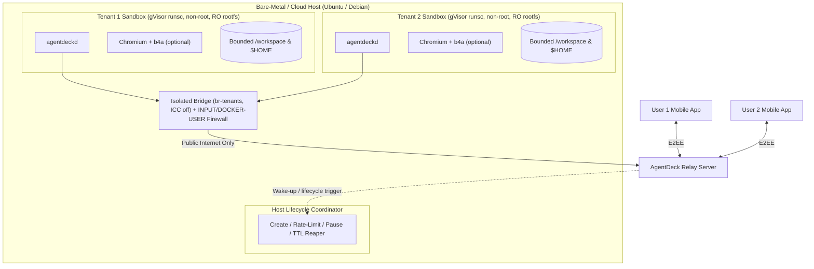

# Cloud Deployment and Environment Isolation Guide

This guide provides setup and configuration recipes for running **AgentDeck Daemon (`agentdeckd`)** and persistent headless browsers (**Chromium + browser4agent**) on remote Linux cloud servers.

---

## Deployment Scenarios Matrix

Choose the setup that best matches your target environment:

| Scenario | Target Audience | Isolation Level | Complexity | Key Highlights |
| :--- | :--- | :--- | :--- | :--- |
| **Scenario 1: Bare-Metal VPS (Direct Host)** | Individual developer running on a dedicated cloud VPS (Hetzner, DigitalOcean, etc.) | Host-level (Single tenant) | ⭐ (Minimal) | Zero virtualization overhead; managed directly via systemd and native CLI. |
| **Scenario 2: Single-User Docker Container** | Individual developer who prefers a clean, containerized setup without polluting host packages | Container-level (Standard Docker) | ⭐⭐ (Moderate) | Clean reproducibility; all development runtimes and browser pre-packaged in one image. |
| **Scenario 3: Multi-Tenant Secure Sandbox & On-Demand Playground** | Teams, SaaS workspaces, or public on-demand demo playgrounds | **Micro-sandbox (gVisor `runsc` + network/disk isolation)** | ⭐⭐⭐ (Production) | User-space kernel isolation; host/sibling/LAN firewall; read-only rootfs & disk/cgroup quotas; on-demand TTL cleanup or 10ms pause/wake. |

---

## Scenario 1: Bare-Metal VPS (Direct Host)

Recommended for personal users who own a dedicated Linux VPS and want their agent and browser running 24/7.

### 1. Install and Start `agentdeckd`
```bash
# 1. Install agentdeckd globally
npm install -g agentdeckd
# Or download the prebuilt binary from GitHub Releases to /usr/local/bin

# 2. Enable systemd user session persistence (Linger)
# Crucial: Ensures background processes stay alive after SSH disconnects and auto-start on boot
sudo loginctl enable-linger $USER

# 3. Register autostart service and start immediately
agentdeckd start

# 4. Check status and view Pairing QR code
agentdeckd status
```
Scan the terminal pairing QR code with your mobile AgentDeck app to complete pairing.

### 2. Install Headless Chromium and Xvfb Virtual Framebuffer
```bash
sudo apt-get update && sudo apt-get install -y \
    xvfb chromium-browser fonts-noto-cjk fonts-wqy-zenhei curl unzip
```
> **Note**: Installing CJK fonts prevents square-box glyph fallback when rendering Asian characters in screenshots and live stream.

### 3. Install and Configure `browser4agent` (b4a)
```bash
# Install CLI / Native Host
sudo curl -fsSL https://github.com/mantou132/browser4agent/releases/latest/download/browser4agent-linux-x86_64.tar.gz | sudo tar -xz -C /usr/local/bin/
sudo chmod +x /usr/local/bin/browser4agent
browser4agent --setup skills

# Download and unpack the browser extension
mkdir -p ~/.config/browser4agent-ext
curl -fsSL https://github.com/mantou132/browser4agent/releases/latest/download/extension-chrome.zip -o /tmp/ext.zip
unzip /tmp/ext.zip -d ~/.config/browser4agent-ext && rm /tmp/ext.zip
```

### 4. Create Background Browser Service (`agentdeck-browser.service`)
Create `/etc/systemd/system/agentdeck-browser.service`:
```ini
[Unit]
Description=Persistent Headless Chromium under Xvfb
After=network.target

[Service]
Type=simple
User=ubuntu
Environment="DISPLAY=:99"
ExecStart=/usr/bin/xvfb-run -n 99 --server-args="-screen 0 1920x1080x24" \
    chromium-browser \
    --no-sandbox \
    --disable-gpu \
    --remote-debugging-port=9222 \
    --user-data-dir=/home/ubuntu/.chrome-user-data \
    --load-extension=/home/ubuntu/.config/browser4agent-ext \
    --no-first-run \
    --no-default-browser-check \
    about:blank
Restart=always
RestartSec=5

[Install]
WantedBy=multi-user.target
```
Enable and start the service:
```bash
sudo systemctl enable --now agentdeck-browser.service
```

---

## Scenario 2: Single-User Docker Container

Packages the complete runtime (Node.js, Python, Git, Chromium, Xvfb, b4a, and `agentdeckd`) into a single non-root container image.

> **Base image note**: Uses `debian:bookworm-slim` because Ubuntu 24.04's `chromium-browser` apt package is a Snap wrapper that fails inside Docker containers.

### 1. Configuration Files

Create an `agentdeck-docker` directory with the following files:

**`Dockerfile`**:
```dockerfile
FROM debian:bookworm-slim

ENV DEBIAN_FRONTEND=noninteractive
ENV DISPLAY=:99
ENV ENABLE_BROWSER=1

RUN apt-get update && apt-get install -y --no-install-recommends \
    curl git wget unzip procps xvfb ca-certificates \
    chromium fonts-noto-cjk fonts-wqy-zenhei \
    python3 python3-pip \
    && curl -fsSL https://deb.nodesource.com/setup_22.x | bash - \
    && apt-get install -y --no-install-recommends nodejs \
    && npm install -g pnpm agentdeckd @anthropic-ai/claude-code \
    && rm -rf /var/lib/apt/lists/*

# Install browser4agent CLI and extension (amd64; adjust archive name for arm64)
WORKDIR /opt/browser4agent
RUN curl -fsSLO https://github.com/mantou132/browser4agent/releases/latest/download/browser4agent-linux-x86_64.tar.gz \
    && tar -xzf browser4agent-linux-x86_64.tar.gz \
    && mv browser4agent /usr/local/bin/ \
    && rm browser4agent-linux-x86_64.tar.gz \
    && curl -fsSLO https://github.com/mantou132/browser4agent/releases/latest/download/extension-chrome.zip \
    && unzip extension-chrome.zip -d /opt/browser4agent-ext \
    && rm extension-chrome.zip

# Run as an unprivileged user
RUN useradd -m -u 1000 -s /bin/bash sandbox \
    && mkdir -p /workspace \
    && chown -R sandbox:sandbox /workspace /home/sandbox

COPY entrypoint.sh /entrypoint.sh
RUN chmod +x /entrypoint.sh

USER sandbox
WORKDIR /workspace
ENTRYPOINT ["/entrypoint.sh"]
```

**`entrypoint.sh`**:
```bash
#!/bin/bash
set -e

# Optional headless browser (set ENABLE_BROWSER=0 for lightweight code-only sandboxes)
if [ "${ENABLE_BROWSER:-1}" = "1" ]; then
    nohup xvfb-run -n 99 --server-args="-screen 0 1920x1080x24" \
        chromium \
        --no-sandbox \
        --disable-gpu \
        --disable-dev-shm-usage \
        --remote-debugging-port=9222 \
        --user-data-dir=/workspace/.chrome-profile \
        --load-extension=/opt/browser4agent-ext \
        --no-first-run \
        --no-default-browser-check \
        about:blank > /tmp/chromium.log 2>&1 &
fi

# Start agentdeckd (outbound WebSocket connection only, no open ingress ports required)
exec agentdeckd run \
    ${PAIRING_ID:+--pairing-id "$PAIRING_ID"} \
    ${RELAY_URL:+--relay-url "$RELAY_URL"} \
    ${FEATURES:+--features "$FEATURES"}
```

### 2. Build and Run
```bash
# Build the image
docker build -t agentdeck-env:latest .

# Run container in interactive mode first to scan the QR code
docker run -it --name my-agentdeck \
  -v ~/my-workspace:/workspace \
  agentdeck-env:latest

# Once paired, detach with Ctrl+P, Ctrl+Q or restart with `docker start my-agentdeck`
```

---

## Scenario 3: Multi-Tenant Secure Sandbox & On-Demand Playground

When hosting environments for multiple independent users or a public on-demand playground on a shared host, AI agents execute arbitrary shell commands and untrusted code. **Never use standard `runc` Docker or default Docker networking for untrusted tenants.**

The isolation goal is: **a compromised container must not be able to escape to the host, reach host/LAN/cloud-metadata services, talk to sibling containers, or exhaust host CPU/RAM/disk/bandwidth.**

This architecture combines:
- **gVisor (`runsc`)** user-space kernel (intercepts syscalls to prevent host kernel exploits)
- **Isolated Docker bridge (`enable_icc=false`) + `INPUT` / `DOCKER-USER` firewall** (blocks host, sibling containers, LAN, and cloud metadata)
- **Read-only rootfs + disk/log/cgroup quotas** (prevents disk-fill and fork-bomb DoS)
- **Non-root + zero capabilities** (defense in depth)
- **Coordinator with concurrency caps & TTL reaper** (safe on-demand creation and cleanup)



> **Deployment tip**: Whenever possible, host untrusted public sandboxes on a dedicated VPS/IP separate from your production Relay or internal services so outbound IP reputation and bandwidth are isolated too.

### 1. Install gVisor Sandbox Runtime
```bash
# 1. Install Docker and runsc
curl -fsSL https://get.docker.com | sh
curl -fsSL https://gvisor.dev/archive.key | sudo gpg --dearmor -o /usr/share/keyrings/gvisor-archive-keyring.gpg
echo "deb [arch=$(dpkg --print-architecture) signed-by=/usr/share/keyrings/gvisor-archive-keyring.gpg] https://storage.googleapis.com/gvisor/releases release main" | sudo tee /etc/apt/sources.list.d/gvisor.list
sudo apt-get update && sudo apt-get install -y runsc

# 2. Register runsc with Docker daemon
sudo runsc install
sudo systemctl restart docker
```
> **Note**: `runsc` defaults to the `systrap` platform and works on standard cloud VPS instances without nested virtualization (unlike Firecracker/Kata).

### 2. Dedicated Tenant Network & Host/Sibling Firewall

`runsc` only isolates the kernel — **it does not isolate networking**. Without explicit firewall rules, a container can still connect to the host via the Docker bridge gateway, hit host services on the host's public IP, scan sibling containers, or steal cloud credentials from `169.254.169.254`.

#### 2.1 Create an Isolated Bridge (Disable Inter-Container Traffic)
```bash
docker network create \
  --driver bridge \
  --subnet 172.30.0.0/16 \
  --gateway 172.30.0.1 \
  -o com.docker.network.bridge.name=br-tenants \
  -o com.docker.network.bridge.enable_icc=false \
  tenant-net
```

#### 2.2 Configure `INPUT` and `DOCKER-USER` Rules
Traffic from containers to the host itself (including `172.30.0.1` and the host's own public IP) hits the **`INPUT`** chain, while forwarded traffic to other networks and the internet hits **`DOCKER-USER`** (never append to `FORWARD`, where Docker inserts its own `ACCEPT` rules first).

```bash
HOST_PUBLIC_IP="<YOUR_HOST_PUBLIC_IP>"   # e.g. 203.0.113.10
BRIDGE="br-tenants"

# --- 1. Block ALL container -> host traffic (SSH, Relay, DB, bridge gateway) ---
# Containers will use public DNS (--dns 1.1.1.1) instead of the host resolver.
sudo iptables -I INPUT 1 -i "$BRIDGE" -m conntrack --ctstate ESTABLISHED,RELATED -j ACCEPT
sudo iptables -I INPUT 2 -i "$BRIDGE" -j DROP

# --- 2. Filter forwarded container egress in DOCKER-USER ---
# Flush previous custom rules if re-applying, keeping final RETURN
sudo iptables -F DOCKER-USER

# Allow return traffic for established outbound connections
sudo iptables -A DOCKER-USER -m conntrack --ctstate ESTABLISHED,RELATED -j ACCEPT

# Block private / local / sibling / cloud-metadata networks and host public IP
for CIDR in \
  10.0.0.0/8 \
  172.16.0.0/12 \
  192.168.0.0/16 \
  100.64.0.0/10 \
  169.254.0.0/16 \
  127.0.0.0/8 \
  "${HOST_PUBLIC_IP}/32"
do
  sudo iptables -A DOCKER-USER -i "$BRIDGE" -d "$CIDR" -j DROP
done

# Block common abuse ports (SMTP spam, cryptomining pools)
for PORT in 25 465 587 3333 4444 14444; do
  sudo iptables -A DOCKER-USER -i "$BRIDGE" -p tcp --dport "$PORT" -j DROP
done

# Limit concurrent outbound connections per container IP (mitigates port scans / floods)
sudo iptables -A DOCKER-USER -i "$BRIDGE" -p tcp --syn \
  -m connlimit --connlimit-above 128 --connlimit-mask 32 -j REJECT --reject-with tcp-reset

# Allow remaining public egress, then return
sudo iptables -A DOCKER-USER -j RETURN
```

> **IPv6 & Persistence**:
> - If IPv6 is enabled on Docker, mirror the same drops in `ip6tables` (`INPUT -i br-tenants -j DROP`, plus `DOCKER-USER` drops for `fc00::/7`, `fe80::/10`, `::1/128`, and the host's public IPv6), or keep IPv6 disabled on `tenant-net` (default).
> - Save rules with `sudo apt-get install -y iptables-persistent && sudo netfilter-persistent save` (or run the script via a systemd unit on boot).
> - For stricter anti-abuse on public playgrounds, also add egress bandwidth shaping with `tc` on `br-tenants`.

### 3. Disk Quotas & Storage Isolation

A plain `-v /data/tenants/user:/workspace` bind mount has **no capacity limit** — one `fallocate` command or runaway log loop inside a container can fill the host disk and crash the host and all sibling containers.

Always enforce three layers:
1. **Immutable root filesystem**: pass `--read-only` to `docker run`.
2. **Bounded container logs**: pass `--log-opt max-size=10m --log-opt max-file=3`.
3. **Bounded writable mounts**:
   - **Ephemeral on-demand sandboxes (simplest)**: mount `/workspace`, `/home/sandbox`, and `/tmp` as size-limited `--tmpfs` volumes (counted against container memory). Zero host disk is touched and `docker rm -f` leaves zero residue.
     > **Important**: `agentdeckd` stores its config, logs, skills, and downloaded agent binaries (such as `opencode` for the built-in `free` agent) under `$HOME/.local/share/agentdeck`. Keep `exec` enabled on `/home/sandbox` (do not add `noexec`) so managed agents can run.
   - **Persistent multi-tenant workspaces**: use either an XFS filesystem with `pquota` (`xfs_quota`), or a fixed-size sparse ext4 loopback image per tenant:
     ```bash
     # Example: create a 2GB hard-capped ext4 volume for one persistent tenant
     USER_DIR="/data/tenants/${USER_ID}"
     mkdir -p "${USER_DIR}/mnt"
     truncate -s 2G "${USER_DIR}/disk.img"
     mkfs.ext4 -q "${USER_DIR}/disk.img"
     sudo mount -o loop,nodev,nosuid "${USER_DIR}/disk.img" "${USER_DIR}/mnt"
     sudo chown -R 1000:1000 "${USER_DIR}/mnt"
     ```
   - Optional IO throttling: add `--device-write-bps /dev/sda:20mb` (adjust device name) if running heavy disk workloads.

### 4. Hardened Tenant Launch Templates

#### Option A: Ephemeral On-Demand Sandbox (Public Playground / Review)
Ideal for "click to try" public sandboxes: no browser by default (`ENABLE_BROWSER=0`), `free` agent only, fully in-memory bounded storage, destroyed on expiry.

```bash
SANDBOX_ID="demo_$(openssl rand -hex 4)"
PAIRING_ID="adk1_$(openssl rand -base64 32 | tr '+/' '-_' | tr -d '=')"

docker run -d \
  --name "sandbox-${SANDBOX_ID}" \
  --runtime=runsc \
  --network=tenant-net \
  --dns=1.1.1.1 --dns=8.8.8.8 \
  --read-only \
  --cap-drop=ALL \
  --security-opt=no-new-privileges:true \
  --user 1000:1000 \
  --cpus="1.0" \
  --memory="1536m" \
  --memory-swap="1536m" \
  --pids-limit=256 \
  --log-opt max-size=10m \
  --log-opt max-file=3 \
  --tmpfs /tmp:rw,nosuid,nodev,size=128m \
  --tmpfs /home/sandbox:rw,nosuid,nodev,exec,uid=1000,gid=1000,size=512m \
  --tmpfs /workspace:rw,nosuid,nodev,uid=1000,gid=1000,size=256m \
  -e ENABLE_BROWSER=0 \
  -e PAIRING_ID="${PAIRING_ID}" \
  agentdeck-env:latest
```
> **Note**: Leaving `RELAY_URL` unset uses `agentdeckd`'s default Relay (`wss://agentdeck.xianqiao.wang/ws`). If you want browser support in the sandbox, set `ENABLE_BROWSER=1` and raise `--memory` to at least `3g`–`4g` and `--pids-limit` to `1024`.

#### Option B: Persistent Multi-Tenant Workspace
Mount the tenant's quota-enforced volume (containing `workspace/` and `home/`):

```bash
USER_ID="user_1001"
PAIRING_ID="adk1_xxxxxxxx"
USER_MNT="/data/tenants/${USER_ID}/mnt"   # Quota-capped volume from Step 3

mkdir -p "${USER_MNT}/workspace" "${USER_MNT}/home"

docker run -d \
  --name "tenant-${USER_ID}" \
  --runtime=runsc \
  --network=tenant-net \
  --dns=1.1.1.1 --dns=8.8.8.8 \
  --restart=unless-stopped \
  --read-only \
  --cap-drop=ALL \
  --security-opt=no-new-privileges:true \
  --user 1000:1000 \
  --cpus="2.0" \
  --memory="4g" \
  --memory-swap="4g" \
  --pids-limit=1024 \
  --log-opt max-size=10m \
  --log-opt max-file=3 \
  --tmpfs /tmp:rw,nosuid,nodev,size=256m \
  -v "${USER_MNT}/workspace:/workspace" \
  -v "${USER_MNT}/home:/home/sandbox" \
  -e ENABLE_BROWSER=1 \
  -e PAIRING_ID="${PAIRING_ID}" \
  -e RELAY_URL="wss://agentdeck.xianqiao.wang/ws" \
  -e CLAUDE_CODE_OAUTH_TOKEN="${USER_TOKEN}" \
  agentdeck-env:latest
```

> **Security Note**: `agentdeckd` maintains an outbound persistent WebSocket connection to the Relay. **Never expose or map host ingress ports (`-p`)**, and never mount `/var/run/docker.sock` or host directories into tenant containers.

### 5. Lifecycle, Anti-Abuse & Public Playground Rules

#### 5.1 Trust Model & Isolation Boundaries
- **One Pairing ID = one shared host**: All devices connected to the same Pairing ID share the same filesystem and all sessions.
- **Never expose a review/private container publicly**: Keep App Store / Google Play review environments on their own private container and Pairing ID so public users cannot alter sample workspaces or leave unwanted content.
- **Never put owner API keys into public sandboxes**: Use the built-in `free` agent, or route model calls through a host/external proxy that issues short-lived, rate-limited per-sandbox tokens.

#### 5.2 On-Demand Coordinator Requirements (Public Playground)
A lightweight HTTP coordinator sitting in front of `docker run` should enforce:
1. **Per-user ephemeral container**: Generate a fresh `adk1_` Pairing ID on request and return its QR code / `agentdeck://connect?pairingId=...` deep link (avoid sharing one container across strangers unless explicitly labeled as a shared public board that resets on a cron schedule).
2. **Global concurrency cap**: Reject new requests once active `sandbox-*` containers reach your RAM ceiling (e.g. `(host_ram_gb - 2) / per_sandbox_ram_gb`).
3. **Entry rate limiting**: Apply per-IP rate limits and a lightweight bot challenge (e.g. Cloudflare Turnstile) before spawning a container.
4. **Hard TTL reaper**: Run a periodic cleanup loop (every 1–5 min) that inspects container labels/creation time and executes `docker rm -f` once a sandbox exceeds its idle limit (e.g. 20 min) or hard max lifetime (e.g. 60 min).

#### 5.3 Idle Suspension & Wake-Up (Persistent SaaS Tenants)

For persistent paid/team tenants rather than ephemeral demos:

1. **Idle Freeze (10ms pause via cgroups)**:
   When an instance has been idle for 30 minutes without RPC traffic:
   ```bash
   docker pause tenant-user_1001
   ```
   CPU usage immediately drops to 0%, preserving all memory state.
2. **Instant Message Wake-Up (5–10ms unpause)**:
   When the Relay server receives a new request from the user's phone for an inactive host, it triggers the host coordinator:
   ```bash
   docker unpause tenant-user_1001
   ```
   `agentdeckd` instantly reconnects to Relay, providing an imperceptible wake-up experience on mobile.
3. **Deep Cold Storage (Memory Reclamation)**:
   For containers paused for over 6 hours, run `docker stop` to release physical RAM; cold restart via `docker start` takes under 2 seconds.

---

## Universal Agent & Browser Workflows

Regardless of which scenario you deploy, the interaction experience on your mobile phone is uniform:

### 1. Headless Web Login via QR Code
* When an agent navigates to a login-protected site, the QR code renders in the headless Chromium memory buffer;
* The agent invokes `browser4agent --tool screenshot_tab` and outputs a Markdown image:
  ```markdown
  Please scan this QR code on your phone to log in:
  
  ```
* The user long-presses or scans the image directly on mobile;
* Session cookies and storage persist permanently in the mounted Chrome profile.

### 2. Live Screen Streaming to Mobile
The agent outputs a screen block to stream real-time browser views to the phone:
````markdown
```agentdeck-screen
browser:<tabId>
```
````
The mobile app renders a screen card. Tapping it opens **Live View**, where `agentdeckd` streams JPEG frames captured from local `http://127.0.0.1:39271/mcp` over Relay ephemeral frames.

### 3. Workspace Instructions
Place an `AGENTS.md` file in the root of your workspace to instruct agents on browser usage:
```markdown
## Environment Conventions
- You are running on a cloud environment with persistent Chromium and the browser4agent extension.
- Use `browser4agent` tools or CLI for browser automation.
- When login is required, take a screenshot of the QR code and render it in Markdown for the user.
- To present browser output or visual verification, use the `agentdeck-screen` block.
```
